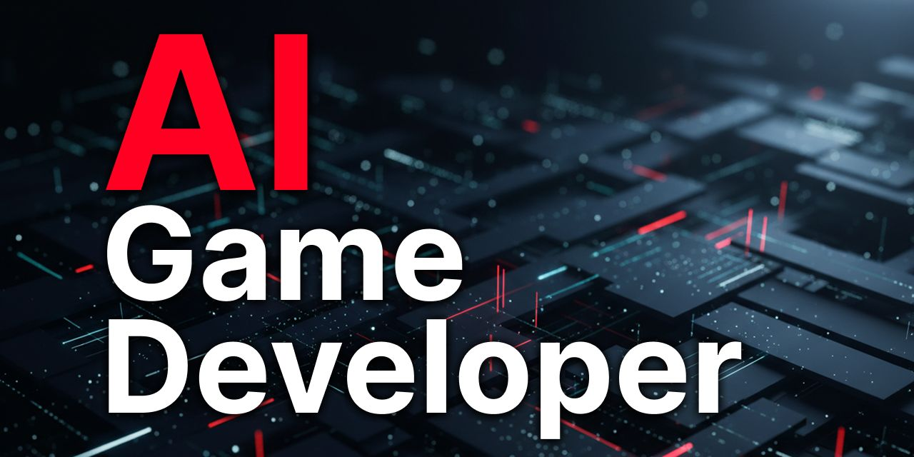

<div align="center" width="100%">

  <h1>✨ AI Game Developer — <i>GameDev MCP Server</i></h1>

[](https://www.nuget.org/packages/com.IvanMurzak.GameDev.MCP.Server/)
[](https://modelcontextprotocol.io/introduction)
[](https://github.com/IvanMurzak/Unreal-MCP)
[](https://github.com/IvanMurzak/Unity-MCP)
[](https://github.com/IvanMurzak/Godot-MCP)</br>
[](https://discord.gg/cfbdMZX99G)
[](https://github.com/IvanMurzak/GameDev-MCP-Server/stargazers)
[](https://github.com/IvanMurzak/GameDev-MCP-Server/blob/main/LICENSE)
[](https://hub.docker.com/r/aigamedeveloper/mcp-server)
[](https://stand-with-ukraine.pp.ua)

  

  <p>
    <a href="https://claude.ai/download"></a>&nbsp;&nbsp;
    <a href="https://openai.com/index/introducing-codex/"></a>&nbsp;&nbsp;
    <a href="https://www.cursor.com/"></a>&nbsp;&nbsp;
    <a href="https://code.visualstudio.com/docs/copilot/overview"></a>&nbsp;&nbsp;
    <a href="https://gemini.google.com/"></a>&nbsp;&nbsp;
    <a href="https://antigravity.google/"></a>&nbsp;&nbsp;
    <a href="https://code.visualstudio.com/"></a>&nbsp;&nbsp;
    <a href="https://www.jetbrains.com/rider/"></a>&nbsp;&nbsp;
    <a href="https://visualstudio.microsoft.com/"></a>&nbsp;&nbsp;
    <a href="https://github.com/anthropics/claude-code"></a>&nbsp;&nbsp;
    <a href="https://github.com/cline/cline"></a>&nbsp;&nbsp;
    <a href="https://github.com/Kilo-Org/kilocode"></a>
  </p>

</div>

Engine-agnostic [Model Context Protocol](https://modelcontextprotocol.io/) server shared by the game-engine MCP plugins:

- [Unity-MCP](https://github.com/IvanMurzak/Unity-MCP) — Unity Editor & games
- [Godot-MCP](https://github.com/IvanMurzak/Godot-MCP) — Godot Editor & games
- [Unreal-MCP](https://github.com/IvanMurzak/Unreal-MCP) — Unreal Editor & games

<div align="center" width="100%">

  

</div>

It is a thin host over the NuGet packages [`com.IvanMurzak.McpPlugin.Server`](https://www.nuget.org/packages/com.IvanMurzak.McpPlugin.Server) and [`com.IvanMurzak.ReflectorNet`](https://www.nuget.org/packages/com.IvanMurzak.ReflectorNet), where all the real server logic lives. The server bridges MCP clients (Claude, Cursor, Copilot, …) and an engine plugin over SignalR:

```
MCP client  ⇄  gamedev-mcp-server  ⇄ (SignalR) ⇄  engine plugin (Unity / Godot / Unreal)
```

There is **no engine-specific code** in this repository — one server binary serves all three engine plugins. Tools, resources and prompts are provided dynamically by whichever engine plugin connects.

> **Not to be confused with** [AI-Game-Dev-Server](https://ai-game.dev) — the cloud LLM/billing proxy. This project is the **local** MCP stdio/http proxy host.

## Install / Run

### Pre-built executables

Download the zip for your platform from [Releases](https://github.com/IvanMurzak/GameDev-MCP-Server/releases) (`gamedev-mcp-server-<rid>.zip` — `win-x64`, `win-x86`, `win-arm64`, `linux-x64`, `linux-arm64`, `osx-x64`, `osx-arm64`), unzip, and run:

```bash
./gamedev-mcp-server --port 8080 --client-transport stdio
```

Typical MCP client configuration (stdio):

```json
{
  "mcpServers": {
    "GameDev-MCP": {
      "command": "path/to/gamedev-mcp-server",
      "args": ["--port=8080", "--client-transport=stdio"]
    }
  }
}
```

### Docker

```bash
docker run -i --rm -p 8080:8080 aigamedeveloper/mcp-server
```

### dotnet tool

```bash
dotnet tool install --global com.IvanMurzak.GameDev.MCP.Server
gamedev-mcp-server --port 8080
```

### Build from source

```bash
dotnet build com.IvanMurzak.GameDev.MCP.Server.csproj
dotnet run --project com.IvanMurzak.GameDev.MCP.Server.csproj -- --client-transport stdio --port 8080
```

Cross-platform self-contained executables for all 7 RIDs: `python build/build_all.py` (Python 3.9+, any OS; pass RIDs to build only some). Outputs land in `publish/<rid>/` and are zipped as `gamedev-mcp-server-<rid>.zip` (skip zipping with `--no-zip`; zip existing outputs with `--zip-only`).

## Configuration

CLI arguments override environment variables.

| Environment variable | CLI argument | Default | Description |
| --- | --- | --- | --- |
| `MCP_PLUGIN_PORT` | `--port` | `8080` | Client → Server ← Plugin connection port |
| `MCP_PLUGIN_CLIENT_TIMEOUT` | `--plugin-timeout` | `10000` | Plugin → Server connection timeout (ms): one attempt of a catalog / prompt / resource request to the plugin. Tool calls do not use it (see `--tool-timeout`) |
| `MCP_PLUGIN_TOOL_TIMEOUT` | `--tool-timeout` | `300000` (or `--plugin-timeout` if larger) | How long one tool call may run in the plugin (ms). A tool call is sent to the plugin once and never re-sent; on timeout or a dropped connection it fails, and the tool may still be running in the editor. Raise it for long editor operations (builds, imports). Servers after 9.2.12 only (built on McpPlugin 8.11.0) |
| `MCP_PLUGIN_CLIENT_TRANSPORT` | `--client-transport` | `stdio` | Client → Server transport: `stdio` or `streamableHttp` |
| `MCP_PLUGIN_IDLE_TIMEOUT_SECONDS` | `--idle-timeout-seconds` | `28800` | streamableHttp idle-session eviction window (this host seeds 8h instead of the package default of 600s, so a local session survives a working day). Multi-tenant hosts should lower it and use a Redis session-migration record for long-window resumption |
| `MCP_AUTH` | `--auth` | transport-dependent (see [Authentication](#authentication)) | Authentication mode: `none`, `token` or `oauth` |
| `MCP_PLUGIN_TOKEN` | `--token` | — | The shared secret of `token` mode. Required for it, ignored by `none` and `oauth` |
| `MCP_AUTH_ISSUER` | `--auth-issuer` | — | OAuth authorization-server URL (e.g. `https://ai-game.dev`). Required for `oauth` |
| `MCP_PUBLIC_URL` | `--public-url` | — | This server's canonical public URL / token audience (e.g. `https://ai-game.dev/mcp`). Required for `oauth`; seeds the Origin allow-list |
| `REDIS_URL` | — | — | streamableHttp: stores sessions and their SSE events in Redis, so a session survives a server restart. Unset: a restart loses every session (see [Sessions and restarts](#sessions-and-restarts)) |
| `MCP_REDIS_KEY_PREFIX` | — | `mcp-server:` | Key namespace when several servers share one Redis |
| `MCP_BIND` | `--bind` | `loopback` | Bind address: `loopback`, `any` (0.0.0.0), or a specific IP. Hosted deploys behind a proxy set `any`/`0.0.0.0` |
| `MCP_ALLOWED_ORIGINS` | `--allowed-origins` | — | Comma/semicolon-separated additional allowed browser Origins (added to loopback + the `--public-url` origin) |
| `MCP_SSE_KEEPALIVE_SECONDS` | — | `30` | streamableHttp: seconds of silence before an SSE comment is sent on the standalone GET stream, so idle clients and proxies do not drop it (the TS SDK's default fetch gives up after 300 s without a byte). `0` turns it off |
| `MCP_SENTRY_DSN` / `MCP_SENTRY_ENVIRONMENT` | — | — | Opt-in crash reporting to a Sentry-compatible endpoint (e.g. GlitchTip): unhandled exceptions only, no PII, tagged `service=mcp-server`. Unset = off |
| `MCP_LOG_LEVEL` | — | `Info` | Log verbosity floor: `Trace`, `Debug`, `Info`, `Warn`, `Error`, `Fatal`. Read by NLog, so unlike the rest of this table it has no CLI equivalent |

Logs are written to `logs/server-log.txt` (and `logs/server-log-error.txt`); in stdio mode console logging is redirected to stderr so stdout stays clean for the MCP JSON stream.

The default level is `Info`. Set `MCP_LOG_LEVEL=Trace` to dump every MCP message
body while debugging a protocol issue — but expect volume: on a busy hosted
deployment Trace measured 39-54k lines/min (5-12 GB/day), which rotates
`server-log.txt` (10 MB x 5 archives) down to roughly ten minutes of retained
history. Lower verbosity keeps *more* usable history, not less.

## Authentication

The server is an OAuth 2.1 **resource server**, with an offline shared-secret mode beside it. Three modes:

| Mode | Auth | Default for | Use |
| --- | --- | --- | --- |
| `none` | none — single-instance, zero-config | **stdio** | offline / local dev / CI |
| `token` | one shared bearer secret (`MCP_PLUGIN_TOKEN`), compared in constant time; `401` without it | explicit `--auth token` / `MCP_AUTH=token` only | self-hosted, one project, no authorization server |
| `oauth` | ES256 JWT validated locally via cached JWKS (with PAT introspection fallback); `401` + `resource_metadata` challenge | **streamableHttp** | signed-in localhost **and** hosted |

- **Transport-conditional default:** `stdio` defaults to `none`. `streamableHttp` defaults to `oauth` **when both `--auth-issuer` and `--public-url` are configured**; otherwise it stays on `none` and logs a warning (so the zero-config `docker run` / `--port 8080` quickstart still works). An explicit `--auth` always wins.
- **`oauth` requires** `--auth-issuer` (the authorization server, e.g. `https://ai-game.dev`) **and** `--public-url` (this server's canonical audience). Startup fails fast if either is missing while `--auth oauth` is set.
- **`token` mode** applies to streamableHttp AI clients and to the engine plugin: both must send the secret. In Godot-MCP that means `GODOT_MCP_TOKEN` (see its README); a plugin that sends none, or a wrong one, is disconnected, and `tools/list` then returns an empty list (the server's own tools exist only in `oauth` mode). The secret crosses cleartext HTTP unless TLS terminates in front of the server.
- **Origin validation** (DNS-rebinding defense) runs in **all** modes: a request with a non-allowed `Origin` gets `403`. Loopback and the `--public-url` origin are allowed by default; add more with `MCP_ALLOWED_ORIGINS`.
- **Bind** defaults to loopback. Set `--bind any` (or `0.0.0.0`) for a hosted deployment a reverse proxy must reach.

```bash
# Local, offline (stdio, none) — unchanged zero-config default:
gamedev-mcp-server --client-transport stdio --port 8080

# Hosted resource server (streamableHttp, oauth), reachable by nginx:
gamedev-mcp-server --client-transport streamableHttp --port 8080 \
  --auth oauth --auth-issuer https://ai-game.dev --public-url https://ai-game.dev/mcp \
  --bind 0.0.0.0

# Self-hosted with one shared secret, in a container:
docker run -p 8080:8080 -e MCP_PLUGIN_CLIENT_TRANSPORT=streamableHttp -e MCP_PLUGIN_PORT=8080 -e MCP_BIND=any \
  -e MCP_AUTH=token -e MCP_PLUGIN_TOKEN=<secret> aigamedeveloper/mcp-server
```

## Sessions and restarts

An MCP session lives in the server process. What a streamableHttp client sees when that process restarts depends on `REDIS_URL`:

| | With `REDIS_URL` | Without |
| --- | --- | --- |
| The session | Survives for the migration-record lifetime (`MCP_SESSION_MIGRATION_TTL_SECONDS`, default the idle window, 8 h from `initialize`): the same session id keeps working for the user who created it | **Lost** |
| The client's next request | Works | `404` with JSON-RPC error `-32001` (`Session not found`) |
| What the client must do | Nothing, within that lifetime; past it, or while Redis is unreachable, as in the other column | Start a new session with `initialize` |
| The catalogue | The first standalone GET stream of the rehydrated session gets one `list_changed` per capability that declares it, because changes made meanwhile reached no one: list again | A new session lists it anyway |

Without a store there is nothing a restarted server could restore: it no longer knows the session or the client's protocol version, so the `404` is the correct signal, and the MCP specification tells the client to re-initialize on it. The C# (`ModelContextProtocol` 2.4.0) and TypeScript (1.32.2) SDK clients report the error and leave re-initializing to the application, so an application that does not handle it stays failed until it reconnects. Configure Redis when clients must survive a server update.

A persisted session belongs to its creator: a different authenticated user presenting its id gets `403` while the session is live, and the same `404` after a restart, until the owner has resumed it.

## Configure an AI agent

Write a project-scoped, pinned MCP client config for any supported AI agent from the terminal — no editor UI, no token copy/paste (native OAuth authorize):

```bash
# Local server, current project:
gamedev-mcp-server configure --agent claude-code
# Hosted server:
gamedev-mcp-server configure --agent codex --url https://ai-game.dev/mcp
# List agents:
gamedev-mcp-server configure --help
```

Each written config is **URL-only** (credentials are never written into project files) and carries the project pin (`…/p/<pin>` path segment) plus, for local servers, the deterministic per-project port — so agent sessions launched in this project folder route strictly to this project's engine. `--agent <id>` accepts any id from `configure --help` (e.g. `claude-code`, `codex`, `cursor`, `vscode-copilot`, …); `--transport stdio` writes a stdio spawn config instead of an HTTP one; `--project <path>` targets a different project root (default: current directory).

## Compatibility

| GameDev-MCP-Server | McpPlugin.Server | ReflectorNet | Engine plugins |
| --- | --- | --- | --- |
| **9.3.2** (current) | 8.15.0 | 5.5.1 | engine plugins on McpPlugin **8.x** |
| 9.2.4 (last 7.x) | 7.5.2 | 5.4.0 | engine plugins on McpPlugin **7.x** |
| 8.0.3 (legacy) | 6.11.0 | 5.3.1 | engine plugins on McpPlugin **6.x** |

Server releases `9.2.5` and newer build against McpPlugin **8.x**; `9.0.0`–`9.2.4` build against McpPlugin **7.x** (the instance-metadata handshake + `oauth` mode), and McpPlugin 6.x plugins pair with the `8.0.3` line.

Tool-call argument checks (McpPlugin.Server 8.14.0+): a plugin on McpPlugin **8.14.0** or newer (it reports `mcpPluginVersion` in its handshake) gets server-side tool-argument validation (required arguments and types) and the 8.14 call guard (one whole-call deadline, reload/re-send handling); an older plugin, or one that reports no version, has its calls forwarded as server 9.2.x forwarded them: no argument validation, no whole-call deadline, no rewriting of its errors. Only a call carrying a lone UTF-16 surrogate, which cannot be delivered to any plugin, is refused with a clear error. Connections keep 9.2.x's newest-wins replacement too: the editor/runtime roles (the editor is kept when a game connects, game-only tools go to the game) apply only when both connections are 8.14+ plugins. One timing difference remains: an old plugin's connection replaces the previous one at its version handshake (milliseconds after connecting), not at connect.

Tool errors on the direct endpoint (McpPlugin 8.15.0+ plugins): a tool that throws because of what the request asked for (e.g. code that does not compile) answers `POST /api/tools/{name}` with **422** and the tool's message (`Tool execution failed for '<tool>': <message>`); a fault in the plugin (`NullReferenceException` and similar) stays 500. The `/mcp` channel is unchanged (an `isError` result with the tool's message). Older plugins report every thrown exception as 500 on any server.

For the exact pins of an intermediate version, see its entry on [Releases](https://github.com/IvanMurzak/GameDev-MCP-Server/releases) — this table tracks the current release and the last release on each earlier McpPlugin major rather than every patch, so it does not go stale between them.

## License

[Apache-2.0](LICENSE) — Copyright (c) 2026 Ivan Murzak
