<div align="center">



[](https://www.nuget.org/packages/com.IvanMurzak.GameDev.MCP.Server/) [](https://hub.docker.com/r/aigamedeveloper/mcp-server) [](https://dotnet.microsoft.com/download/dotnet/9.0) [](https://github.com/IvanMurzak/GameDev-MCP-Server/actions/workflows/test_pull_request.yml)<br>[](https://github.com/IvanMurzak/GameDev-MCP-Server/blob/main/LICENSE) [](https://discord.gg/cfbdMZX99G) [](https://stand-with-ukraine.pp.ua)

</div>

**GameDev MCP Server** is the one [Model Context Protocol](https://modelcontextprotocol.io/) server behind the [Unity-MCP](https://github.com/IvanMurzak/Unity-MCP), [Godot-MCP](https://github.com/IvanMurzak/Godot-MCP) and [Unreal-MCP](https://github.com/IvanMurzak/Unreal-MCP) plugins. It sits between your AI agent and the game editor: the agent speaks MCP to the server, the engine plugin connects to it over SignalR, and every tool, prompt and resource comes from the plugin. There is no engine-specific code here — it is a thin ASP.NET Core host over the NuGet packages [`com.IvanMurzak.McpPlugin.Server`](https://www.nuget.org/packages/com.IvanMurzak.McpPlugin.Server) and [`com.IvanMurzak.ReflectorNet`](https://www.nuget.org/packages/com.IvanMurzak.ReflectorNet).



> You usually do not install this yourself: each engine plugin downloads and starts the matching server version. Install it directly to run it in Docker, on a server, or from your own scripts.
>
> Not to be confused with [AI-Game-Dev-Server](https://ai-game.dev), the cloud service. This project is the local MCP host.

## Features

✅ **One server, three engines** — Unity, Godot and Unreal plugins share one binary<br>✅ **Two transports** — `stdio` for spawned servers, `streamableHttp` for URL clients<br>✅ **Auth modes** — `none` locally, a shared `token`, or `oauth` for signed-in use<br>✅ **Agent setup** — `configure --agent <id>` writes a pinned, URL-only client config<br>✅ **Survives restarts** — with `REDIS_URL`, HTTP sessions outlive a server restart<br>✅ **Runs anywhere** — executables for 7 platforms, Docker image, .NET global tool

## Install

- **Executable** — `gamedev-mcp-server-<rid>.zip` from [Releases](https://github.com/IvanMurzak/GameDev-MCP-Server/releases) for Windows, Linux and macOS
- **Docker** — `docker pull aigamedeveloper/mcp-server` (`linux/amd64`, `linux/arm64`)
- **.NET tool** — `dotnet tool install --global com.IvanMurzak.GameDev.MCP.Server` (needs the .NET 9 runtime)

## Quick start



**Run it.** The default is `stdio` on port `8080`; the engine plugin connects to that port.

```bash
gamedev-mcp-server --port 8080 --client-transport stdio
```

**Let an agent spawn it** (stdio MCP client config):

```json
{
  "mcpServers": {
    "GameDev-MCP": {
      "command": "path/to/gamedev-mcp-server",
      "args": ["--port=8080", "--client-transport=stdio"]
    }
  }
}
```

**Or configure an agent for this project in one command:**

```bash
gamedev-mcp-server configure --agent claude-code   # configure --help lists every agent
```

**Docker.** Inside a container the server must listen on all interfaces (`MCP_BIND=any`), or the port mapping cannot reach it:

```bash
docker run --rm -p 127.0.0.1:8080:8080 \
  -e MCP_PLUGIN_CLIENT_TRANSPORT=streamableHttp -e MCP_BIND=any \
  aigamedeveloper/mcp-server
```

## Configuration

Every option is an environment variable or a CLI argument (arguments win). The ones you will reach for:

| CLI argument | Environment variable | Default | Meaning |
| --- | --- | --- | --- |
| `--port` | `MCP_PLUGIN_PORT` | `8080` | Port for AI clients and the engine plugin |
| `--client-transport` | `MCP_PLUGIN_CLIENT_TRANSPORT` | `stdio` | `stdio` or `streamableHttp` |
| `--tool-timeout` | `MCP_PLUGIN_TOOL_TIMEOUT` | `300000` | Max time for one tool call (ms) |
| `--auth` | `MCP_AUTH` | by transport | `none`, `token` or `oauth` |
| `--bind` | `MCP_BIND` | `loopback` | `loopback`, `any` or an IP |

The full list, logging and the `configure` command: [docs/configuration.md](docs/configuration.md).

## Documentation

- [Configuration](docs/configuration.md) — every option, logs, `configure --agent`
- [Hosting and authentication](docs/hosting.md) — `none` / `token` / `oauth`, bind and Origin rules, Docker, sessions and Redis
- [Compatibility](docs/compatibility.md) — server ↔ McpPlugin ↔ ReflectorNet versions and plugin-dependent behavior

Current release **9.5.2** is built on McpPlugin.Server **8.23.0** and ReflectorNet **5.5.2**, for engine plugins on McpPlugin **8.x**.

## Build from source

```bash
dotnet build com.IvanMurzak.GameDev.MCP.Server.csproj
dotnet run --project com.IvanMurzak.GameDev.MCP.Server.csproj -- --client-transport stdio --port 8080
dotnet test tests/GameDev.MCP.Server.Tests/GameDev.MCP.Server.Tests.csproj
```

Self-contained executables for all 7 platforms: `python build/build_all.py` (Python 3.9+, any OS; pass RIDs to build only some). Output lands in `publish/<rid>/` and is zipped as `gamedev-mcp-server-<rid>.zip`.

## Related

- Engine plugins: [Unity-MCP](https://github.com/IvanMurzak/Unity-MCP) · [Godot-MCP](https://github.com/IvanMurzak/Godot-MCP) · [Unreal-MCP](https://github.com/IvanMurzak/Unreal-MCP)
- Server core: [MCP-Plugin-dotnet](https://github.com/IvanMurzak/MCP-Plugin-dotnet) · [ReflectorNet](https://github.com/IvanMurzak/ReflectorNet)
- Community: [Discord](https://discord.gg/cfbdMZX99G)

## License

[Apache-2.0](LICENSE) — Copyright © 2026 Ivan Murzak
